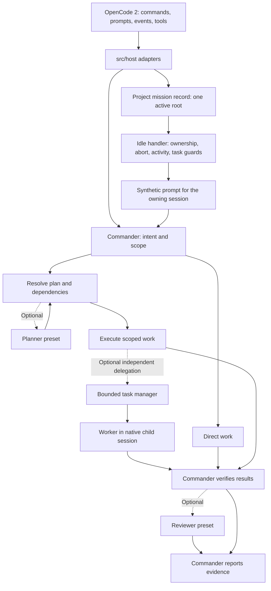

# System Architecture

Date: 2026-10-29 (OpenCode 2 only; HostClient boundary and removed subsystems reviewed, ADR-0028)

This document describes the current architecture that is directly verifiable from the repository source. It intentionally avoids speculative performance claims.

## 1. Entry Points

| Surface | File | Responsibility |
| --- | --- | --- |
| OpenCode plugin boundary | `src/index.ts` | Default export `{ id, setup }`. OpenCode treats every module export as a plugin, so nothing else is exported. |
| Host setup | `src/host/plugin.ts` | `setupPlugin` creates the HostClient, initializes the runtime, registers session/tool hooks, agents, tools and commands, starts the event bridge, and returns the instance's dispose function. |
| Host client | `src/host/client.ts` | `createHostClient` implements the `HostClient` interface over the OpenCode 2 plugin context and owns the session status map the event bridge writes. |
| Event bridge | `src/host/event-bridge.ts` | Subscribes to host events, drops other locations' events, and translates OpenCode 2 events into the shapes `src/plugin-handlers/event-handler.ts` consumes. |
| Agents, tools, commands | `src/host/agent-adapter.ts`, `tool-adapter.ts`, `command-adapter.ts`, `tool.ts` | Register the four agents, the plugin tools (`codemode: false`), and the slash commands. `tool.ts` defines the local `tool()` / `ToolDefinition` / `ToolContext` contract. |
| Plugin runtime bootstrap | `src/plugin-runtime.ts` | Parses options, creates this instance's task manager, context-limit resolver, tools and handler context, and registers cleanup. |
| npm CLI launcher | `src/cli.ts` → `dist/cli.js` | Selects one supported bundled Rust binary, forwards argv and inherited stdio without a shell, and preserves child exit status. |
| Rust CLI | `crates/orchestrator-cli/src/main.rs` | Dispatches `serve`, metadata, and explicit terminal commands. |
| Shell listener CLI | `crates/orchestrator-cli/src/shell_listener.rs` | Runs the authorized-lab TCP session listener and line-mode TUI outside OpenCode RPC. |

### HostClient boundary

The core (task manager, mission loop, recovery, pending injections) depends only on `HostClient` in `src/host/client.ts`, not on the OpenCode plugin types:

- `createSession({ parentID?, title })` returns the new session id; `parentID` keeps the host's parent/child link and inherited location.
- `prompt({ sessionID, text, agent?, synthetic?, reply? })` optionally switches agent, then sends a user or synthetic prompt; `reply` (default `true`) starts a model turn.
- `interrupt(sessionID)` resolves `true` when the host confirms the stop.
- `removeSession(sessionID)` throws `SessionDeletionUnavailableError` on hosts whose context lacks `session.remove`.
- `messages(sessionID)` returns flattened `HostMessage` records (role, times, error, finish reason, text, tool-call count).
- `statuses()` lists only non-idle sessions; an absent session is idle. The event bridge updates the map.
- `modelContextLimit(providerID, modelID)` reads the host model list.

Host API failures throw; callers do not inspect `{ error }` responses.

## 2. Runtime Shape

OpenCode Orchestrator is an OpenCode 2 plugin with four generated agents:

These are selectable presets, not required stages. Commander distinguishes questions, reviews, planning, and implementation before choosing work. Small changes stay in the primary session. A plan precedes implementation that depends on it; independent workers may run in parallel after their scope is known. Review is optional and explicit.

| Agent | Mode | Role |
| --- | --- | --- |
| Commander | `primary` | Owns the mission loop and top-level coordination. |
| Planner | `subagent` (hidden) | Breaks work into ordered steps and research tasks. |
| Worker | `subagent` (hidden) | Implements scoped changes. |
| Reviewer | `subagent` (hidden) | Verifies completion evidence and integration risk. |



The dotted edges are optional. The mission continuation path applies only to its owning session; ordinary questions do not activate it. Native child sessions are owned by OpenCode, while the retained manager supplies bounded admission and result tracking.

`src/host/agent-adapter.ts` updates the four agents by name through the host agent transform, setting only description, system prompt, mode and the hidden flag. It does not set a model or permissions; those follow OpenCode's own agent configuration. `agentTemperatures` is applied per request in the session context hook. Worker completion does not automatically launch Reviewer; review is requested deliberately when needed.

Delegation (`delegate_task`) rejects unknown agent names. Built-in agents run as themselves and already carry their system prompt in the host, so the delegated prompt is not prefixed again. Custom agents run as Commander with their role prepended (`src/core/agents/manager/prompt-routing.ts`).

Agent instructions come from host configuration. Orchestrator does not register a system-transform hook. `src/plugin-handlers/mission-context.ts` builds the current mission, scratchpad, step count, and background-task context only for the active persisted mission's owner. The session context hook appends it as a user-role model message after existing messages. It edits the outgoing request only, without calling a prompt API or persisting extra turns. Repeated transforms of the same request replace their own trailing addition. The host's system blocks and conversation prefix remain in place. See [ADR-0025](adr/0025-mission-context-prefix-caching.md).

Prompt definitions are four short role presets using `src/agents/prompts/common.ts` and the shared philosophy. The slash-command templates (`/task`, `/plan`, `/agents`, `/stop`, `/cancel` in `src/tools/slashCommand.ts`) and runtime continuation/checkpoint prompts follow the same discipline. Planning does not require file creation or delegation. A context checkpoint does not claim that OpenCode compaction has completed.

The Commander prompt instructs the model to treat `[Compressed conversation section]` blocks as historical context, even when a context-pruning plugin carries them in a user-role message. A real instruction accompanying or following a summary still takes precedence. Orchestrator does not rewrite another plugin's message roles (issue #48).

OpenCode loads extensions. Orchestrator does not inspect or execute files in `.opencode/plugins`. Its internal `HookRegistry` is a small ordered adapter for owned callbacks. Registration order in `src/hooks/index.ts` defines execution order. Pre-tool hooks return allow or block. Every assistant-done hook runs; the first one that injects owns the next turn. `StrictRoleGuardHook` checks OpenCode's `bash` tool and `run_background`. `MemoryGateHook` is only an assistant-done hook and does not capture tool output.

The outgoing message guard runs in the session context hook. Text and reasoning text above 200,000 JavaScript string characters retain a prefix plus a truncation marker. Oversized inline image strings are replaced with an omission notice. Oversized tool file URIs become text content items, so providers never decode a notice as image/file bytes. Oversized serialized structured tool results become capped text; error results retain their error discriminator. Small structured results and files remain intact, as do standalone media parts, tool-call inputs, encrypted reasoning and provider metadata. This is a per-field safeguard, not a total token budget or a replacement for host compaction.

Native web tools remain owned by OpenCode. The plugin registers 24 tools: ten search/Git/utility wrappers, four background-command tools, three AST/LSP tools (`src/tools/registry.ts`), and seven task/TODO tools (`src/tools/parallel/index.ts`). Slash commands are host commands, not tools.

The retained task manager is the sole completion authority. Foreground delegation waits on its state instead of polling the host independently. The poller runs at a fixed interval, reads `statuses()` and `messages()`, and finishes a task only on a completed, error-free assistant message created since the task started whose finish reason is not `tool-calls`, `unknown` or `error`. A failed message read does not fail a healthy task. Launch errors throw with their cause and reach the model as `[ERROR] Failed: <cause>`. Launch and resume share admission ownership. Resume rechecks task identity and its start marker after asynchronous routing and activity reads. Pending cancellation cannot release another task's slot, and running cancellation requires a confirmed host interrupt. A foreground wait timeout does not cancel its task.

Concurrency (`src/core/agents/concurrency.ts`) is a per-agent FIFO queue with an acquisition timeout. The limit is `agentConcurrency[agent]`, else `defaultConcurrency`, else 10; `0` means unlimited. Limits are never raised automatically.

OpenCode 2 serves several directories from one process. It loads one plugin instance per location and disposes an instance when its location goes idle (ADR-0027). Each instance owns its task manager, session registry and context-limit resolver, and passes them through the handler context. Project state is keyed by directory: TODO files, custom agents, memory, metrics and mission options. Tools read the directory from the native tool context. The event bridge drops events whose location belongs to another instance. Process-wide services, such as the Rust tool pool and background commands, shut down only when the last live instance is disposed.

Plugin tools register with `codemode: false`, like OpenCode's built-in tools. Without it OpenCode 2 hides a tool in the code-mode catalog behind `execute`, and a direct call fails with "No tool named".

Task notices reach the parent session as synthetic prompts; a model turn starts only when all of that parent's tasks are done. A notice for a busy parent is queued, and queued notices are flushed as one synthetic prompt at its next genuine idle. Failed sends remain pending. Deferred delivery rechecks ownership after asynchronous status reads. Rate-limit errors are left to the host's own retry; session recovery does not report them as recovered.

Transport failures are not automatically replayed. Rust RPC drains output under backpressure and rejects outstanding requests on shutdown. Background commands resolve working directories from the native tool context and report termination only after confirmation; finished jobs are pruned after 30 minutes on the next `run`, and their timers do not keep the process alive. Rust command deadlines include pipe draining and stdin completion; AST/LSP failures remain distinguishable from valid empty diagnostics or search results. Every JSON-RPC request with an id receives a reply, including JSON-RPC error objects for malformed or unknown requests. Shell-outs treat non-zero git and `diff` trouble exits as errors. The curl-backed `http` tool sends request bodies on stdin and limits requests and redirects to http/https. Captured process output is capped at 16 MiB per stream: text tools (`diff`, `jq`, `http`, `git_diff`, `git_status`) return `truncated: true` when that happens, and tools that parse JSON output (`ast_search`, ESLint diagnostics) report an explicit "output exceeded" error instead of a parse failure. Search tools report `truncated`/`timed_out` instead of silently returning partial results; exclusion filters apply to paths relative to the search root. `jq` runs with a cleared environment. `ast-grep` is pinned to an exact version. The `diff` tool needs a `diff` binary on `PATH`; on Windows that means installing diffutils. Desktop notification text and sound paths cross the process boundary only as argument arrays or child-only environment values.

Rust grep and sed inclusion patterns select files without pruning their ancestor directories; hidden and excluded-directory rules retain precedence. Mgrep checks its shared deadline before each traversal step and reports collection timeouts even when no searchable files were collected. Diff counts changed lines inside unified hunks, including content that begins with `++` or `--`; when `truncated` is true, both the text and counts describe only the captured prefix.

## 3. Configuration Contract

OpenCode 2 passes scoped options through the package object in `opencode.json(c)`:

```jsonc
{
  "plugins": [
    {
      "package": "opencode-orchestrator",
      "options": {
        "agentConcurrency": {
          "Commander": 1,
          "Worker": 4
        },
        "missionLoop": {
          "ledger": true,
          "markdownMemory": true,
          "maxEvidenceEvents": 20
        }
      }
    }
  ]
}
```

All options are defined in `src/core/config/options.ts`. One Zod schema is both the runtime contract and the source of `opencode-orchestrator.schema.json` (`scripts/gen-schema.ts`). `parseOrchestratorOptions` is tolerant: an invalid field falls back to its default, and keys this version no longer reads are ignored. Agent-keyed maps use exact agent names. Options are captured per plugin instance; restart the backend to apply changes.

| Option | Effect |
| --- | --- |
| `customRendering` | Appends the timestamp/step/duration footer to tool results; defaults to `true` (issue #52). Post-tool hooks, including secret redaction, still run when it is `false`. |
| `agentTemperatures` | Per-agent sampling temperature (0 to 2), applied in the session context hook. |
| `agentConcurrency` | Concurrent delegated tasks per agent; `0` means unlimited. |
| `defaultConcurrency` | Limit for agents without their own entry; default 10, `0` means unlimited. |
| `acquisitionTimeoutMs` | How long a launch waits for a slot; default 300000. |
| `contextMaxTokens` | Context window assumed for every model, overriding the host model list. |
| `missionLoop.ledger`, `missionLoop.markdownMemory`, `missionLoop.maxEvidenceEvents` | Mission ledger output, generated markdown memory, and evidence window. |

`ContextLimitResolver` (`src/core/context/context-limit-resolver.ts`) resolves a model's window from `contextMaxTokens`, then its cache, then `HostClient.modelContextLimit`, then a 200,000-token default.

## 4. Permission Model

The plugin does not copy or rewrite permissions. OpenCode 2 applies its own `permission` configuration to the registered agents and plugin tools. Project instruction files are not copied into generated agent prompts; OpenCode owns the rules layer through `AGENTS.md` and `instructions`.

## 5. Mission Loop Control Plane

Mission loop state is file-backed under `.opencode/`:

| Artifact | Producer | Purpose |
| --- | --- | --- |
| `.opencode/loop-state.json` | `src/core/loop/mission-loop.ts` | Active mission state and iteration counter. |
| `.opencode/mission-ledger.jsonl` | `src/core/loop/mission-ledger.ts` | Event trail when ledger output is enabled; trimmed to the newest 100 events on write. |
| `.opencode/docs/brain/scratchpad.md` | `src/core/knowledge/mission-memory.ts` | Generated markdown memory surface. |
| `.opencode/docs/brain/knowledge-map.canvas` | `src/core/knowledge/mission-memory.ts` | Obsidian-compatible mission graph. |
| `.opencode/docs/brain/memories/*.md` | `src/core/knowledge/mission-memory.ts` | Generated memory projections for local inspection. |

`startMissionLoop()` persists the mission state. `handleMissionIdle()` re-verifies completion before scheduling a continuation. Pure verification-count and continuation-metadata policy lives in `src/core/loop/mission-continuation.ts`; effectful host checks, persistence and prompt injection remain in the handler. `generateMissionContinuationPrompt()` sends a compact `<mission_loop iteration="N">` prompt containing the objective, verification summary, stagnation signal and completion rule. There is no iteration maximum. The stagnation count is a single counter in `src/core/loop/progress-tracker.ts`, persisted as `stagnationCount`.

Verification treats only `[x]` TODO items as complete; `[ ]`, in-progress `[/]` and failed `[-]` items are incomplete.

The current record is project-wide: one active root owns it. A new `/task` from another root interrupts a busy owner, cancels its delegated tasks without notifying the retired parent, and replaces the record only after those operations succeed. The expected prior mission identity is checked again before the write, so a concurrent change rejects a stale replacement. Existing TODO and checklist files are retained for the new mission to reconcile. This is not per-root multi-mission storage. Abort/pause protection is process-local, and delegated task state is in memory.

The chat mission hook handles activation and cancellation only. The idle handler owns mission verification and continuation. Unreadable TODO state, unknown host status, and pending/running delegated tasks cannot establish completion.

## 6. Continuation Guards

The plugin avoids immediate self-resume after interruption or unstable state. Current guard paths:

1. `src/plugin-handlers/event-handler.ts` requires an assistant completion for the current user turn before idle continuation is allowed.
2. `src/core/loop/mission-loop-handler.ts` cancels its countdown on user interaction or abort.
3. `src/core/loop/mission-loop-handler.ts` skips prompt injection while the session is aborting, recovering, busy, or holding running background tasks.
4. Mission idle continuation opens its circuit (`src/core/loop/circuit-breaker.ts`) only after repeated identical text-only assistant turns. Repeated tool calls do not by themselves stop a mission.

The compaction hook contributes context only. The `session.compacted` event (translated from OpenCode 2's `session.compaction.ended`) cancels any countdown scheduled before compaction.

Countdowns recheck mission identity, abort state, host activity, and delegated work after asynchronous reads. A real user message releases the abort latch; a synthetic prompt or late assistant completion does not.

This is the main protection against `/task` immediately restarting after `Esc` or other interrupt paths.

## 7. Authorized Shell Listener Control Plane

`orchestrator shell-listener` is a Rust CLI-only control plane for owned lab machines or explicitly authorized test environments. It is deliberately not registered in `src/tools/registry.ts`, so OpenCode model tool calls cannot start or drive an interactive shell session through the plugin JSON-RPC path.

Runtime flow:

1. `main.rs` dispatches the explicit `shell-listener` command.
2. `shell_listener.rs` binds a TCP listener with `127.0.0.1:4444` as the default address.
3. Non-loopback binds are rejected unless the operator passes `--allow-remote`.
4. Each accepted TCP stream receives a stable session id, peer metadata, a writer handle, an in-memory preview buffer, and a raw log path.
5. Reader threads append raw bytes to `.opencode-orchestrator/shell-listener/` and send sanitized preview events to the line-mode TUI.
6. Operator commands select sessions, send prompt responses, run sentinel-marked one-shot commands, or close sessions. A malformed command prints its error and the prompt continues; only `quit`, end of input, or a stdin read error ends the loop.

| Concern | Owner | Boundary |
| --- | --- | --- |
| Connection acceptance | Listener thread | TCP socket accept and session registration. |
| Session I/O | Per-session reader plus writer handle | Raw bytes are logged; preview bytes are sanitized for display. |
| Human operation | Line-mode TUI | The operator decides what to send and when to send it. |

Completion detection remains heuristic because shells do not emit a universal "command finished" event. The `run <cmd>` path appends a unique sentinel marker. Long-running or interactive programs should stay in `send <text>` mode.

## 8. Builder-Inspired Memory Surface

The generated markdown scratchpad and `.canvas` graph are the main Builder-derived ideas retained here:

1. Keep runtime memory local-first under the workspace.
2. Generate a readable markdown scratchpad instead of introducing a separate database.
3. Treat the graph as a visualization and navigation artifact, not as a second source of truth.

`src/core/knowledge/mission-memory.ts` writes these artifacts using `mission-note.ts` for frontmatter parsing, escaping, and temporary-file replacement. Generated notes carry only tags, title, `keep`, level, importance, session, time and objective; no decay or lifecycle metadata is written. Because `MemoryManager` is in-memory only, a resync after a plugin restart sees no expected notes; pruning therefore removes only unpinned notes tagged `mission-memory`, and never `keep: true` notes or user-written files that share the `project-`/`mission-`/`task-` prefix.

`MemoryGateHook` records notable assistant turns in `MemoryManager`; that memory is prepended to delegated prompts. `src/plugin-handlers/mission-context.ts` includes the compact scratchpad in the request-only context message. Knowledge-note indexing and RAG prompt injection were retired by [ADR-0019](adr/0019-retire-knowledge-rag-subsystem.md). The parser deliberately retains its limited frontmatter syntax rather than providing general YAML decoding.

## 9. Release and Platform Baseline

Current verified release baseline:

1. Node.js `>=24.15.0`
2. OpenCode 2; `@opencode/plugin` `2.0.22` is the development-only, type-only host contract. The package has no OpenCode runtime dependency; its runtime dependencies are `jsonc-parser` and `zod`.
3. GitHub Actions build matrix for Linux x64/arm64, macOS x64/arm64, and Windows x64 in `.github/workflows/release.yml`

The development gate uses TypeScript `7.0.2`, Vitest `5.0.1`, and explicit Node 24 types. Rust builders and CI are pinned to `1.98.1`. The release workflow requires coverage, npm audit, dependency validation, Rust formatting, Clippy with warnings denied, and all Rust tests before publishing can run.

The Linux x64 and arm64 release binaries are built inside a Debian Bookworm Rust container. Both artifacts must execute on Debian Bookworm before upload; the arm64 check uses QEMU on the x64 runner.

Tags are the only publishing trigger. The hosted matrix builds all five supported binaries from the tagged source, then verifies the exact artifact set, executable format, CPU architecture, and embedded package version. An isolated packed install (`scripts/package-smoke.mjs`) checks the plugin entry and the generated `orchestrator` npm command before the npm publish. A manual workflow run on a branch can run QA and builds but cannot publish a package. The repository ignores `bin/`; versioned executables exist only as local build outputs or artifacts rebuilt from the exact release tag.

OpenCode 2 owns registration and removal through `opencode plugin add/remove`. The npm package and Rust CLI do not rewrite OpenCode configuration during installation or removal. OpenCode 1 is not supported; OpenCode 1 users stay on 2.0.19. See [ADR-0028](adr/0028-opencode-2-only-minimal-core.md), [ADR-0024](adr/0024-opencode-2-plugin-compatibility.md), [ADR-0027](adr/0027-per-location-plugin-instances.md), and [ADR-0021](adr/0021-minimal-mission-plugin.md) for pending deletion gates.

Package metadata separates the project homepage from issue reporting:

- `homepage`: `https://agnusdei1207.github.io/opencode-orchestrator/`
- `bugs.url`: `https://github.com/agnusdei1207/opencode-orchestrator/issues`

## 10. Verification Pointers

When verifying architecture-sensitive changes, open these files first:

1. `src/index.ts`
2. `src/host/plugin.ts`
3. `src/host/client.ts`
4. `src/host/event-bridge.ts`
5. `src/plugin-runtime.ts`
6. `src/core/config/options.ts`
7. `src/plugin-handlers/event-handler.ts`
8. `src/plugin-handlers/chat-message-handler.ts`
9. `src/core/agents/concurrency.ts`
10. `src/core/agents/manager/task-poller.ts`
11. `src/core/loop/mission-loop.ts`
12. `src/core/loop/mission-loop-handler.ts`
13. `src/core/loop/mission-continuation.ts`
14. `crates/orchestrator-cli/src/shell_listener.rs`
